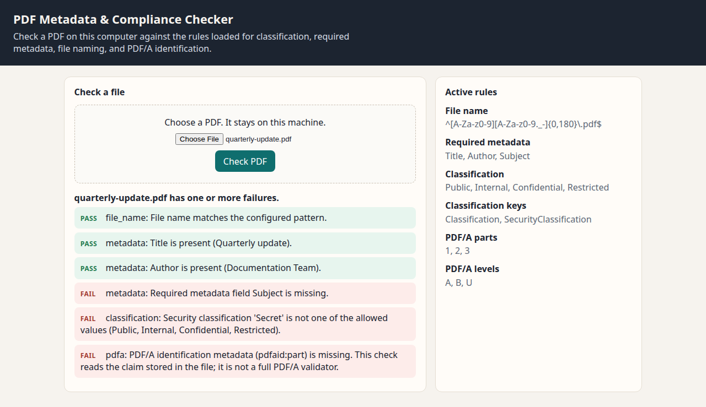

# PDF Metadata & Compliance Checker

A local checker for PDF files used in document-management systems. Point it at a file and a JSON rules file. It reports whether the file name, required metadata, security classification, and PDF/A identification claim meet those rules.

The file is read on the machine where you run the tool. Nothing is sent to a remote service.

## What it checks

- **File name.** The file name, without its folder path, must match a regular expression you set.
- **Required metadata.** Each listed field, such as Title, Author, and Subject, must be present in the PDF information dictionary or XMP.
- **Security classification.** A configured metadata key must contain one of the allowed labels. Keywords can also carry the label when that option is on.
- **PDF/A.** The file must include PDF/A identification metadata (`pdfaid:part` and, when configured, `pdfaid:conformance`). This reads the claim stored in the file. It is not a full PDF/A profile validator.

Turn any of these checks on or off, and change the field names, labels, and pattern, in `rules.json`.

## How to run

```bash
python3 -m venv .venv
source .venv/bin/activate
pip install -r requirements.txt
python -m pdfcheck check examples/project-overview.pdf
python -m pdfcheck check examples/quarterly-update.pdf
python -m pdfcheck serve
```

Then open http://127.0.0.1:8765 and choose a PDF. Use `--rules path/to/rules.json` when the rules file is not `./rules.json`. Add `--json` to print a JSON report, or `--html report.html` to write a standalone report.

The examples are synthetic one-page PDFs generated for this tool. `project-overview.pdf` passes the shipped rules. `quarterly-update.pdf` is missing a subject, uses a classification label outside the allowed list, and has no PDF/A identification metadata.

## Rules

`rules.json` in this folder is the default configuration:

| Key | Purpose |
| --- | --- |
| `file_name.pattern` | Regular expression matched against the file name |
| `file_name.ignore_case` | When true, the pattern ignores letter case |
| `required_metadata` | Metadata field names that must be present |
| `classification.keys` | Metadata keys that may hold the classification label |
| `classification.allowed_values` | Labels that count as a present classification |
| `classification.search_keywords` | Also accept a label found as a whole word in keywords |
| `pdfa.accepted_parts` | Accepted PDF/A parts, such as `"1"`, `"2"`, and `"3"` |
| `pdfa.accepted_conformance` | Accepted levels, such as `"A"`, `"B"`, and `"U"` |

Set `enabled` to `false` on `file_name`, `classification`, or `pdfa` to skip that check.

## Screenshot



## Author

Author: Jeerana Noymanee

## License

Released under the [MIT License](LICENSE).
